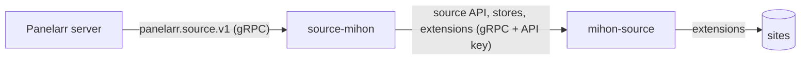

# source-mihon

A [Panelarr](https://github.com/panelarr) source plugin for Mihon extensions. It serves the sources of a [mihon-source](https://github.com/panelarr/mihon-source) instance to the Panelarr server, keeps the extension stores and extensions you configure in mihon-source, and forwards the network profiles (proxies, solvers, rate limits) the server assigns to each source.



mihon-source does the work: it runs the extensions, caches results, checks source health and refreshes stores. source-mihon is the Panelarr side: it declares the configuration it needs, passes every call through (retrying while mihon-source can't be reached), and maps mihon-source's errors to the source API's.

## Running it

The Panelarr server can start it as a managed plugin, or run it as a service next to mihon-source:

```sh
source-mihon --listen :8904 --api-key PLUGIN_KEY
# with MIHON_SOURCE_URL=http://mihon-source:8902 and MIHON_SOURCE_API_KEY=msk_… in the environment,
# or with the configuration the server sends (SetConfig)
```

See [docs/](docs/README.md) for the configuration, what it does and how to check it.

## Development

You need Go (the version in `go.mod`) and `make`, and a [source-api](https://github.com/panelarr/source-api) checkout next to this one (`go.mod` points at `../source-api` until it is tagged).

```sh
make setup   # installs pinned tools into ./bin
make check   # format check, vet, lint, the proto pin, govulncheck and tests
make e2e     # end to end against a real mihon-source built from ../mihon-source (needs a JDK 21)
make help    # lists every target
```

## Licence

GNU General Public License v3.0 or later ([LICENSE](LICENSE)). The vendored mihon-source protos in `third_party/mihon-source/` are under the Apache License 2.0.
